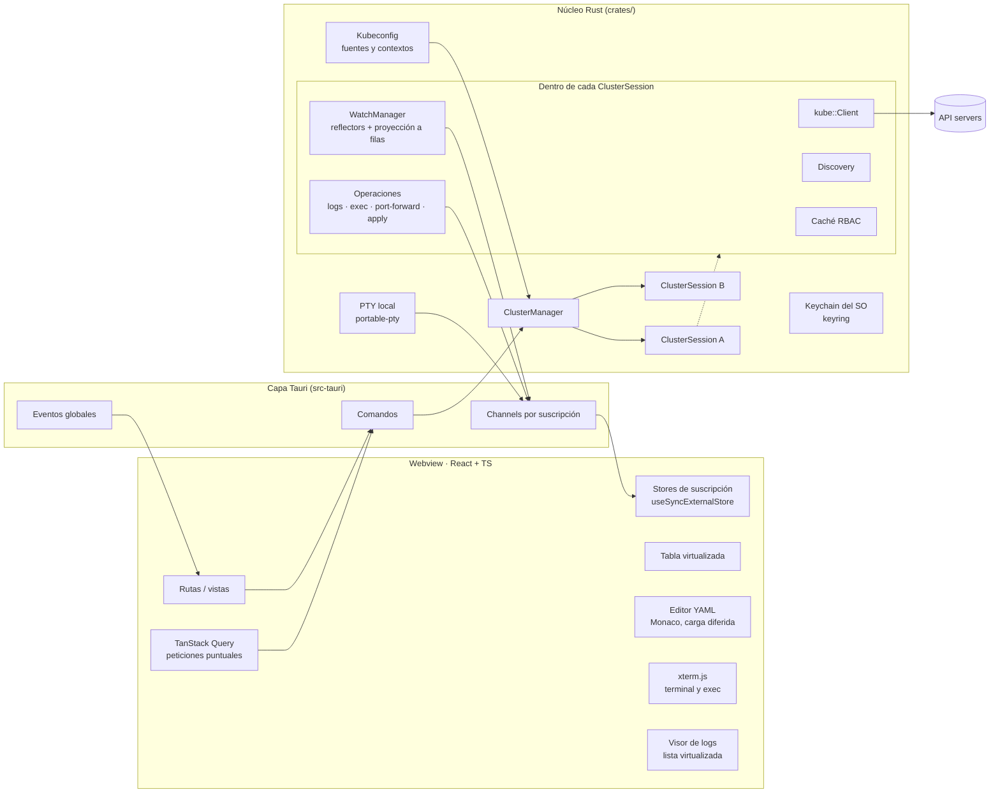
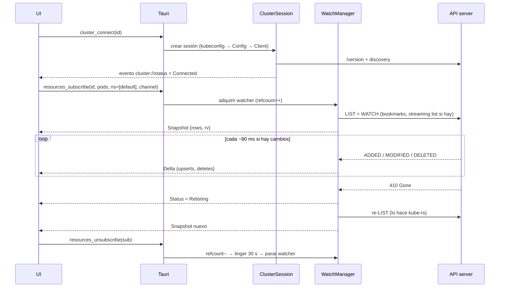

# 01 · Arquitectura

Oculus es una app de escritorio con dos mitades: un **núcleo en Rust**, que habla con los clústeres y mantiene el estado, y una **UI en React**, que solo pinta lo que el núcleo le envía. Tauri 2 une las dos con IPC tipado. Todo el conocimiento de Kubernetes (credenciales, watches, RBAC, caché) vive en Rust; la UI no ve un `kubeconfig` ni un token nunca.

## Componentes

| Componente         | Responsabilidad                                                                                                                                                                      |
| ------------------ | ------------------------------------------------------------------------------------------------------------------------------------------------------------------------------------ |
| **Kubeconfig**     | Descubre fuentes (`~/.kube/config`, `KUBECONFIG`, ficheros añadidos), las vigila con `notify` y expone contextos. Guarda solo referencias `(ruta, contexto)`, nunca su contenido.    |
| **ClusterManager** | Registro de sesiones. Conecta/desconecta bajo demanda y publica el estado de conexión de cada clúster.                                                                               |
| **ClusterSession** | Un actor tokio por clúster conectado. Dueño de su `kube::Client`, su discovery, su caché RBAC, sus watches y sus operaciones en curso. Si un clúster falla, los demás no se enteran. |
| **WatchManager**   | Comparte un watcher por `(GVR, ámbito de namespaces)` entre todas las vistas que lo piden. Cuenta referencias, proyecta objetos a filas y envía snapshot + deltas por lotes.         |
| **Operaciones**    | Logs en streaming, exec, port-forward, apply, escalado, reinicio de rollout y borrado. Cada operación de larga duración tiene un id y se puede cerrar.                               |
| **PTY local**      | Terminal integrada con `kubectl` apuntando al contexto correcto, sin copiar credenciales.                                                                                            |
| **Keychain**       | Solo para secretos que crea Oculus (credenciales de Prometheus, claves de IA en fase 2).                                                                                             |

## Flujo de datos

Resumido: **kubeconfig → `kube::Config` → `Client` → watcher/reflector → caché → proyección a filas → Channel → store de la UI → tabla**.

## Modelo de estado

**Backend (fuente de verdad):**
- `ClusterManager`: `HashMap<ClusterId, ClusterSession>` + estado de conexión por clúster.
- `ClusterSession`: `Discovery` (tipos disponibles), caché RBAC con TTL de 5 min, `WatchManager`, tabla de operaciones activas (streams de logs, sesiones de exec, port-forwards).
- `WatchManager`: por cada `(GVR, ámbito)` un `reflector::Store` sin `managedFields` y un mapa `uid → Row` ya proyectado.

**Frontend (vista derivada, desechable):**
- **Colecciones en vivo:** un store externo por suscripción `(clusterId, gvr, namespaces)`, leído con `useSyncExternalStore`. Aplica snapshot y deltas y ofrece selectores (filtrado, ordenación) a la tabla.
- **Datos puntuales** (detalle de un objeto, discovery, comprobaciones RBAC): TanStack Query, que se invalida cuando llega un delta del mismo `uid`.
- **Estado de UI** (pestañas abiertas, clúster activo, filtros, columnas visibles, tema, idioma): Zustand, persistido en disco con `tauri-plugin-store`.

Al reiniciar se restauran las pestañas y filtros, pero **no se conecta a ningún clúster** hasta que el usuario abre uno. Así el arranque no depende de la red.

## Decisiones técnicas

Cada decisión indica qué se eligió, por qué, y qué alternativa se descartó.

### D1 · Shell de escritorio: Tauri 2

- **Por qué:** binarios de ~10–15 MB frente a ~150 MB, y bastante menos memoria en reposo al no llevar Chromium ni Node. Rust en el backend da concurrencia segura para cientos de streams simultáneos.
- **Coste:** cada SO usa un webview distinto (WKWebView, WebView2, WebKitGTK). Hay que probar en los tres; ver [riesgos](06-riesgos.md).
- **Descartadas:** _Electron_ (lo que usa Lens: un único motor de render y un ecosistema enorme, pero pesado justo en lo que queremos mejorar). _Wails + client-go_ (Go tiene el cliente de Kubernetes oficial, pero el IPC de Wails es menos maduro para streaming binario y su ecosistema de plugins es más pequeño).

### D2 · Cliente Kubernetes: kube-rs

- **Por qué:** cubre todo lo que necesitamos: watcher con relist automático ante 410, reflectors, `DynamicObject` para CRDs, exec y port-forward por WebSocket, y autenticación por exec plugins, OIDC y certificados.
- **Descartada:** usar `kubectl` como subproceso para todo (es frágil, lento y obliga a parsear su salida).

### D3 · IPC: Channels para streams, eventos solo para difusión

- **Por qué:** `tauri::ipc::Channel<T>` va a un consumidor concreto, mantiene el orden y admite cuerpo binario (`InvokeResponseBody::Raw`). Esto último hay que verificarlo en la versión de Tauri que se fije, y es clave para exec y PTY porque evita codificar bytes como arrays JSON.
- Los **eventos globales** se reservan para cosas poco frecuentes que interesan a toda la app: estado de clústeres, cambios en kubeconfig y port-forwards activos.
- **Descartada:** usar eventos para todo (difusión a todas las ventanas, sin orden garantizado por consumidor y más carga de serialización).

### D4 · Qué viaja a la UI: filas proyectadas, no objetos

- **Por qué:** un Pod completo pesa entre 5 y 20 KB; su fila (nombre, namespace, edad, estado, reinicios, nodo…) unos 200 bytes. Con 10.000 pods eso son unos 2 MB en vez de más de 100 MB en el webview. El objeto completo se pide al abrir el detalle.
- Las columnas de los tipos nativos se definen en Rust. Las de los CRDs salen de `additionalPrinterColumns`, que el discovery ya trae.
- Los deltas se agrupan cada ~80 ms, así que una tormenta de cambios no provoca 1.000 re-renders.
- **Descartada:** enviar objetos completos y proyectarlos en JS (más fácil al principio, pero no escala).

### D5 · Estrategia de watches

- `kube::runtime::watcher` + `reflector` con **bookmarks** activos y _streaming lists_ cuando el servidor lo admite. kube-rs ya hace el relist ante `410 Gone` y aplica backoff; nuestro trabajo es **mostrar su estado** (inicializando, listo, re-listando, en backoff, error) y no reimplementarlo.
- Los `managedFields` se eliminan del stream antes de guardar nada (reduce memoria un 30–50 %).
- Los **Secrets** se vigilan con `metadata_watcher`: la lista nunca contiene valores. Revelar un valor es una acción explícita (`secret_reveal`).
- **Solo se vigila lo visible.** Las suscripciones cuentan referencias y, al llegar a cero, el watcher sigue vivo 30 s por si el usuario vuelve a la vista.
- Si listar en todo el clúster da 403, se abre un watcher por cada namespace permitido.
- **Descartada:** sondear con LIST periódicos (más carga para el API server y datos siempre atrasados).

> **Implementado en la etapa 2** (`crates/oculus-watch`), con dos cambios:
> - **No hay `reflector::Store`.** Se guardan solo las filas proyectadas (`uid → Row`) y cada objeto se descarta tras proyectarlo. 10.000 pods como `serde_json::Value` no caben en el presupuesto de 150 MB por clúster; el objeto completo se pide al abrir el detalle (D4).
> - **Los relists no envían un snapshot nuevo**, sino un delta con las diferencias, así que la tabla no parpadea.
> - Además: el listado inicial usa `any_semantic()` (caché del API server), los Secrets se vigilan con `Api<PartialObjectMeta>` (solo nombre, namespace, edad y labels) y un 401/403/404 inicial para el watcher con un error definitivo en lugar de reintentar sin fin.

### D6 · Validación de YAML

- **Autoritativa:** server-side apply con `dryRun=All`, que valida exactamente igual que el clúster: admission webhooks, CRDs y políticas.
- **En el editor:** esquemas de `/openapi/v3` cargados en `monaco-yaml` para autocompletar y marcar errores mientras se escribe.
- El editor (Monaco) **se carga solo al abrir la pestaña YAML**: pesa varios MB y no debe afectar al arranque.
- **Descartada:** CodeMirror 6 (mucho más ligero y una opción razonable, pero su validación por JSON Schema para YAML está menos madura que la de `monaco-yaml`). Si Monaco da problemas en WebKitGTK, es el plan B.

> **Etapa 3:** la validación con autoridad no es server-side apply sino un *dry-run* del mismo JSON Patch que se aplicará (ver 03). Monaco se carga en un bloque aparte al abrir la pestaña YAML (unos 3,5 MB que no tocan el arranque). Se queda en **Monaco 0.52.x**: desde 0.53 `createWebWorker` cambió de firma y `monaco-yaml` 5.5 (vía `monaco-worker-manager` 2.0.1) no arranca su validador. Los workers van dentro del bundle (`?worker&inline`) y se crean desde `blob:`, porque WKWebView no los crea desde `tauri://`. La CSP permite `worker-src blob:` y `style-src 'unsafe-inline'`; para lo segundo hace falta `dangerousDisableAssetCspModification: ["style-src"]`, porque si Tauri añade hashes a `style-src` el navegador ignora `'unsafe-inline'` y Monaco pierde sus estilos.

### D7 · Logs: lista virtualizada en vez de xterm.js

- **Desviación del enunciado:** el prompt proponía xterm.js también para logs. Lo cambio porque un terminal no está pensado para buscar, filtrar por texto o nivel, ajustar líneas largas, mezclar contenedores con colores o copiar un rango. Una lista virtualizada (TanStack Virtual) con búffer circular de 50.000 líneas hace todo eso.
- xterm.js se queda para lo que sí es un terminal: **exec en pods** y la **terminal integrada**.

### D8 · Terminal integrada sin copiar credenciales

- Se lanza la shell del usuario en un PTY (`portable-pty`) con `KUBECONFIG=<fichero-mínimo>:<rutas originales>` (separador `;` en Windows).
- El fichero mínimo solo contiene `current-context: <contexto>`. Según las reglas de fusión de kubectl, el primer fichero que define un valor gana, así que `kubectl` usa ese contexto **sin que se haya copiado ningún token ni certificado**.
- Si además hay que fijar un namespace, el fichero mínimo define un contexto nuevo (`oculus-<id>`) con los **nombres** de `cluster` y `user` del original más el `namespace`. Ojo: la fusión toma la entrada de contexto completa del primer fichero, así que un contexto con solo `namespace` quedaría roto. Siguen sin copiarse credenciales: solo nombres. El fichero se crea con permisos `0600` y se borra al cerrar la terminal.
- **Descartada:** el enfoque de Lens (un proxy local autenticado por clúster y un kubeconfig temporal que apunta a él). Es más potente, porque el exec plugin solo se ejecuta una vez, pero exige hacer proxy de upgrades WebSocket/SPDY. Queda como mejora posible.

### D9 · Credenciales

- Oculus **no copia** el contenido de los kubeconfig a su almacenamiento; guarda referencias `(ruta, contexto)` y relee el fichero al conectar.
- Los tokens que generan los exec plugins o los refrescos de OIDC viven solo en memoria.
- El keychain del SO (crate `keyring`) se usa solo para secretos que crea Oculus.
- Nada sensible se escribe en logs ni en informes de errores (la redacción de datos sensibles se prueba con tests).
- **Descartada:** importar los kubeconfig a un almacén propio de la app, aunque sea cifrado. Es cómodo para gestionar clústeres desde la app, pero duplica credenciales, se desincroniza al rotarlas y amplía la superficie de ataque.

### D10 · RBAC en la UI

- Antes de mostrar acciones se consulta `SelfSubjectRulesReview` por namespace (una sola llamada da muchas reglas). Para acciones concretas y ámbito de clúster se usa `SelfSubjectAccessReview`. Los resultados se cachean 5 min.
- La caché **solo sirve para ocultar o deshabilitar** botones: el servidor sigue siendo quien decide. Un 403 inesperado se muestra con claridad e invalida la caché de ese namespace.
- **Descartada:** no consultar permisos e intentar la acción directamente, mostrando el 403 si falla. Es más sencillo, pero la UI ofrecería botones que no funcionan, lo que confunde a los usuarios con permisos limitados, que son justo el caso habitual en clústeres de empresa.

### D11 · Tipos compartidos Rust ↔ TypeScript

- `tauri-specta` genera bindings TS tipados para comandos y eventos a partir de los tipos Rust. Si llamas a un comando con un argumento mal, falla al compilar, no en ejecución.
- **Riesgo:** su soporte de Tauri 2 ha pasado mucho tiempo en RC. Hay que fijar la versión y mantener la integración en una capa fina. **Alternativa de respaldo:** `ts-rs` (solo genera tipos; los wrappers de comandos se escriben a mano).

### D12 · Frontend

- React 19 + TypeScript + Vite; TanStack Router, Query y Virtual; Zustand para estado de UI.
- **Sin TanStack Table** (cambio en la etapa 2): su versión 9 cambió la API y aquí solo hace falta ordenar, filtrar, seleccionar y mostrar u ocultar columnas sobre filas ya proyectadas. Está escrito a mano en `features/explorer/rows.ts`, con claves de orden cacheadas por fila para aguantar 500 cambios/s sobre 10.000 filas.
- Componentes accesibles sobre **Radix UI** con estilos por _design tokens_ en variables CSS (tema claro/oscuro). Tailwind para maquetar.
- i18n con `i18next` (es/en desde el primer día; nada de cadenas sueltas en el código).
- Gráficas (fase 2) con **uPlot**: muy ligero y rápido con series largas.
- **Descartadas:** Redux (demasiada ceremonia para un estado que mayormente llega del backend) y librerías de componentes completas tipo MUI (pesan más y cuesta darles una identidad visual propia).

## Fase 2: puntos de anclaje en la arquitectura

No se implementan ahora, pero el diseño les deja sitio:

- **Métricas:** un `MetricsProvider` por sesión con dos implementaciones. Una sondea `metrics.k8s.io` cada 15 s (no se puede vigilar con watch). La otra consulta Prometheus a través del proxy de servicios del API server (`/api/v1/namespaces/{ns}/services/{svc}:{port}/proxy/...`) y detecta las instalaciones habituales, como kube-prometheus-stack. Las métricas llegan por Channel igual que las filas.
- **Helm:** las releases se guardan en Secrets de tipo `helm.sh/release.v1` (JSON en gzip y base64), así que **listar y leer** se hace en Rust sin dependencias. **Actualizar y hacer rollback** se delega en el binario `helm` como sidecar; no se reimplementa.
- **Extensiones:** no se repite el modelo de Lens, que carga JS arbitrario en la ventana principal sin aislamiento. Habrá dos niveles:
  1. **Declarativas:** un manifiesto que añade columnas, vistas de detalle para CRDs o acciones basadas en plantillas.
  2. **Con código:** componentes WebAssembly (`wasmtime` + interfaz WIT) con permisos por capacidad ("leer Deployments", "llamar a `https://x`"), más UI en un iframe aislado que se comunica con `postMessage`.
- **Topología:** un grafo construido en Rust a partir de owner references, selectores y referencias a volúmenes y ConfigMaps. Se pinta con React Flow y se distribuye con `elkjs`.
- **Asistente IA:** opcional y desactivado por defecto. La clave del proveedor va en el keychain. Antes de enviar nada se muestra exactamente qué contexto sale (estado del pod, eventos, últimas N líneas de log), con valores de Secrets y variables de entorno ya redactados.
