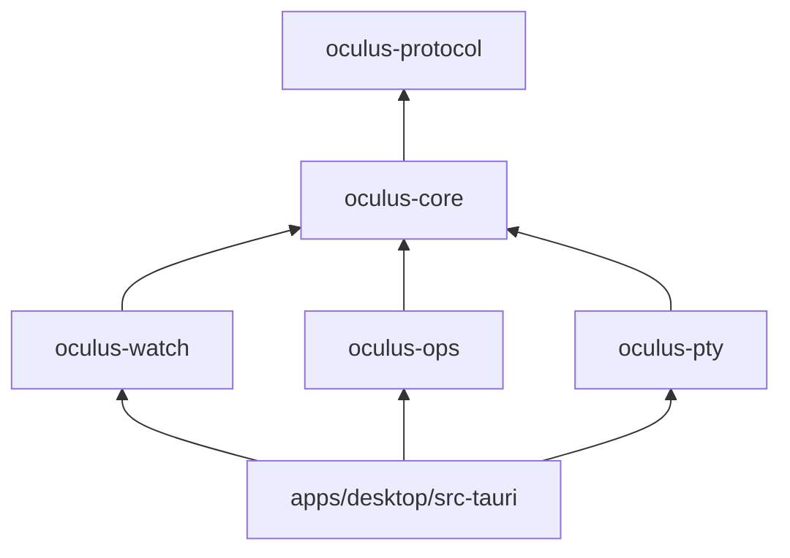

# 02 · Estructura del monorepo

Un workspace de **Cargo** para Rust y otro de **pnpm** para el frontend, en el mismo repositorio. La regla principal: **el núcleo no depende de Tauri**. Así se puede probar sin ventana y, si algún día hiciera falta, reutilizar desde otra shell o desde una CLI.

```
oculus/
├── Cargo.toml                    # workspace Rust
├── pnpm-workspace.yaml           # workspace JS
├── package.json                  # scripts raíz (dev, build, test, lint)
├── rust-toolchain.toml
├── .github/workflows/            # CI: lint, test, build en macOS/Windows/Linux, E2E
│
├── apps/
│   └── desktop/
│       ├── src-tauri/            # crate binario: capa fina sobre el núcleo
│       │   ├── src/
│       │   │   ├── main.rs
│       │   │   ├── lib.rs        # setup de Tauri, plugins, estado compartido
│       │   │   ├── bindings.rs   # registro de comandos/eventos para tauri-specta
│       │   │   └── commands/     # un módulo por área; solo traducen y delegan
│       │   │       ├── kubeconfig.rs
│       │   │       ├── clusters.rs
│       │   │       ├── resources.rs
│       │   │       ├── logs.rs
│       │   │       ├── exec.rs
│       │   │       ├── portforward.rs
│       │   │       ├── terminal.rs
│       │   │       └── settings.rs
│       │   ├── capabilities/     # permisos de Tauri 2 (mínimos)
│       │   ├── icons/
│       │   └── tauri.conf.json
│       ├── src/                  # frontend de la app
│       │   ├── main.tsx
│       │   ├── routes/           # páginas; el árbol de rutas está en router.tsx
│       │   ├── features/
│       │   │   ├── clusters/     # selector, estado, conexión
│       │   │   ├── explorer/     # barra lateral de categorías, tablas
│       │   │   ├── detail/       # panel de detalle, YAML, eventos, relacionados
│       │   │   ├── logs/
│       │   │   ├── exec/
│       │   │   ├── terminal/     # dock inferior
│       │   │   ├── portforward/
│       │   │   └── command-palette/
│       │   ├── stores/           # stores de suscripción y estado de UI
│       │   └── lib/              # cliente IPC, utilidades
│       ├── index.html
│       └── vite.config.ts
│
├── crates/
│   ├── oculus-protocol/          # tipos compartidos con la UI (serde + specta)
│   │                             # ClusterId, ObjectRef, Row, ResourceEvent, OculusError…
│   ├── oculus-core/              # kubeconfig, ClusterManager, ClusterSession,
│   │                             # discovery, RBAC, estado de conexión
│   ├── oculus-watch/             # WatchManager, reflectors, proyección a filas,
│   │   └── src/columns/          # columnas por tipo nativo (pods.rs, deployments.rs…)
│   ├── oculus-ops/               # logs, exec, port-forward, apply, scale, restart, delete
│   └── oculus-pty/               # terminal local (portable-pty, kubeconfig mínimo)
│
├── packages/
│   ├── bindings/                 # TS generado por tauri-specta (no se edita a mano)
│   ├── ui/                       # design system: tokens, componentes sobre Radix
│   └── i18n/                     # catálogos es/en y helpers
│
├── tests/
│   ├── fixtures/                 # manifiestos y scripts kind/k3d/KWOK
│   ├── integration/              # tests Rust contra clústeres reales efímeros
│   └── e2e/                      # WebdriverIO + tauri-driver; Playwright con IPC simulado
│
└── docs/                         # este diseño
```

## Ajustes respecto al diseño (etapa 0)

- Las rutas se definen en código (`router.tsx`), no por ficheros. Se pasará a rutas por ficheros cuando haya suficientes para que compense.
- Los ajustes se guardan desde `oculus-core` (`settings.json` con escritura atómica), no con `tauri-plugin-store`: así se prueban sin Tauri. El plugin queda para el estado de UI (pestañas, filtros) cuando exista.
- `oculus-ops` y `oculus-pty` se crean en la etapa que los necesita.

## Ajustes respecto al diseño (etapa 2)

- `oculus-watch` **no depende de `oculus-core`, sino al revés**: cada `ClusterSession` es dueña de su `WatchManager` y lo cierra al desconectar. `oculus-watch` solo conoce kube-rs y el protocolo; los errores le llegan traducidos por una función de `oculus-core` (para no filtrar secretos).
- La entrada/salida está detrás del trait `Source`: en producción, kube-rs; en los tests, un canal. Así el gestor se prueba sin API server.
- Sin TanStack Table (ver D12).

## Dependencias entre crates



- `oculus-protocol` solo tiene tipos: ni kube-rs ni tokio. Así compila rápido y genera los bindings sin arrastrar nada más.
- `oculus-core` es el único que crea `kube::Client`. Los demás reciben una `ClusterSession`.
- `src-tauri` no tiene lógica de negocio: convierte argumentos, llama al núcleo y traduce errores a `OculusError`.

## Convenciones

- **Lint y formato:** `cargo clippy -D warnings`, `rustfmt`, `biome` para TS.
- **Bindings:** `pnpm gen:bindings` los regenera. En CI se comprueba que no hay diferencias, para que nunca se desincronicen.
- **Commits:** Conventional Commits, que también alimentan el changelog de cada release.
- **Versiones:** se fijan Tauri, kube-rs y tauri-specta, y se actualizan con Renovate en PRs separadas.
